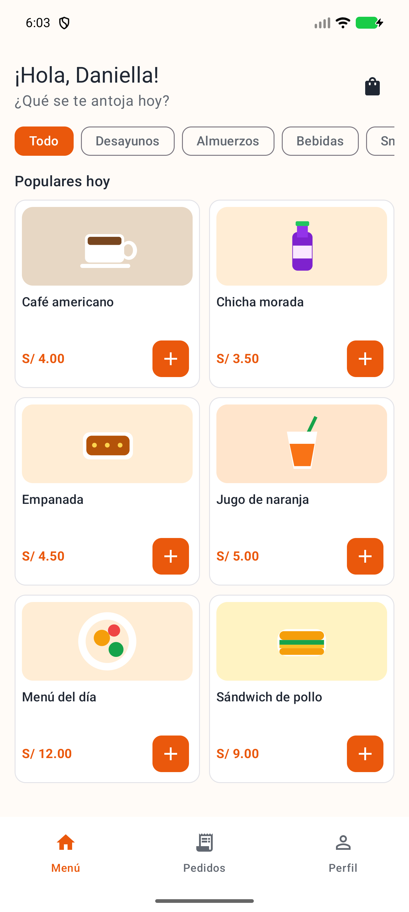
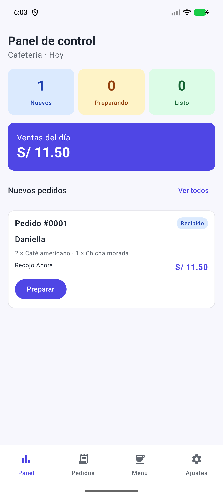

# CafeCampus · Campus fresco

Aplicación Android de pedidos para una cafetería de campus. El estudiante elige productos, confirma un pedido y sigue su estado; el administrador atiende pedidos y administra el menú. Ambos perfiles comparten Room en un mismo dispositivo y las pantallas se actualizan mediante Flow.

## Fase 2: rama mejora-ia

Se parte de la fase 1 terminada en main. La fase 2 agrega búsqueda por nombre sin distinguir tildes ni mayúsculas, repetición desde el historial con precios actuales y un gráfico por hora calculado con Room. También renueva todas las pantallas con la dirección Campus fresco: azul, marfil frío, cítrico y Manrope local.

La interfaz Campus fresco combina cobalto, marfil, acentos rosa/lila y cerámica floral. Los productos comparten tarjetas de igual tamaño; las categorías se abren en un selector y la lupa se transforma en buscador dentro de la cabecera. La navegación permite arrastrar una gota que se estira y se asienta en la siguiente sección. Botones y productos responden al contacto mediante resortes y refracción localizada. No hay tarjetas anidadas ni barra lateral fija.

Liquid Glass es una implementación propia para Android, con AGSL desde API33 y alternativa geométrica en API24–32; no es el material nativo de Apple. Letras e iconos permanecen nítidos. El resto de las pantallas conserva superficies sólidas y sombras suaves. [Investigación, comportamiento y límites](docs/diseno/LIQUID_GLASS.md).

Hay 20 imágenes generadas, incluidos productos, escenas para todas las pantallas, dos fondos y cuatro detalles florales/cerámicos. Los PNG optimizados conservan alfa y procedencia incorporada; funcionan sin conexión. La foto personal de Daniella no se adjuntó aquí y su avatar usa la inicial D.

Los [35 prompts para Gemini](PROMPTS.md) están divididos por funcionalidad: envía solo un bloque cada vez. Cada uno incluye diferencia respecto a la base y reflexión. Son propuestas para reproducir el trabajo; la implementación se preparó con Codex, sin atribuir una sesión inexistente a Gemini.

[Ver la grabación de Liquid Glass en la app](docs/capturas/liquid_glass_real.mp4): arrastre de navegación y transformación del buscador. [Catálogo oscuro](docs/capturas/21_catalogo_oscuro.png) y [categorías desplegables](docs/capturas/20_categorias.png).

## Ejecutar

1. Abre esta carpeta en Android Studio y selecciona el JDK incluido con Android Studio para Gradle (JDK 21 recomendado).
2. Instala Android SDK 35 y sincroniza Gradle. La primera sincronización requiere Internet.
3. Ejecuta `app` en un emulador o dispositivo con Android 7 o superior (API 24).
4. Pulsa Comenzar y usa una cuenta ficticia de la siguiente tabla.

| Perfil | Correo | Contraseña |
| --- | --- | --- |
| Estudiante | daniella@campus.test | 1234 |
| Administrador | admin@cafe.test | admin |

El perfil y el modo oscuro se recuerdan con DataStore. En Perfil o Ajustes puedes cambiar entre las dos cuentas de práctica sin volver a escribir las credenciales. Cerrar sesión vuelve al login. Este mecanismo es exclusivo de la práctica local y usa únicamente los usuarios ficticios de la semilla.

## Tecnología

Kotlin 2.0.21, Compose BOM 2024.09.00, Material 3, Room 2.6.1, KSP 2.0.21-1.0.28, DataStore 1.1.1 y Navigation Compose 2.8.2. Se utiliza AGP 8.7.3 con Gradle 8.11.1 y SDK 35 para mantener las versiones del laboratorio compatibles. El paquete y applicationId del proyecto creado en Android Studio se conservan: `com.leon.cafecampus`.

## Estructura de paquetes

```text
com.leon.cafecampus
├── MainActivity.kt
├── CafeApp.kt
├── data
│   ├── local
│   │   ├── entity       Producto, Usuario, Pedido, DetallePedido
│   │   ├── dao          ProductoDao, UsuarioDao, PedidoDao
│   │   ├── relation     PedidoConDetalle
│   │   ├── CafeDatabase.kt
│   │   └── DatosIniciales.kt
│   ├── repository      CafeRepository, CafeRepositoryRoom
│   └── prefs           PreferenciasStore
├── model               Rol, EstadoPedido, ItemCarrito, PedidosPorHora
├── viewmodel
│   ├── CafeViewModelFactory
│   ├── MenuViewModel
│   ├── SesionViewModel
│   ├── PedidosClienteViewModel
│   ├── PanelAdminViewModel
│   ├── PedidosAdminViewModel
│   └── MenuAdminViewModel
└── ui
    ├── theme
    ├── components
    ├── navigation      Rutas, NavCafe
    ├── cliente         Splash, Login, Menú, Detalle, Confirmar, Seguimiento, Mis pedidos
    └── admin           Panel, Pedidos, Detalle de pedido, Menú, Formulario, Ajustes
```

## Arquitectura MVVM

```text
View (Composable) ──eventos──► ViewModel ──acciones──► CafeRepository (interface)
      ▲                          ▲                           │
      │ collectAsState           │ Flow                      ▼
      └──────────────────────────┘                   CafeRepositoryRoom
                                                           │
                                                           ▼
                                                      DAO → Room

DataStore → SesionViewModel / PedidosClienteViewModel
NavCafe → composición e inyección de ViewModels
```

Las pantallas reciben ViewModels. Los ViewModels dependen de la interface CafeRepository; únicamente su implementación conoce los DAOs. Las lecturas observables usan Flow y las escrituras suspend. NavCafe crea e inyecta las dependencias como punto de composición.

## Datos y reglas

- Se siembran seis productos y dos usuarios ficticios una sola vez, dentro de una transacción.
- Un pedido y sus líneas se guardan juntos; si falla una inserción se revierte toda la operación.
- Cada detalle conserva el nombre y el precio al confirmar. Editar o eliminar el producto no altera pedidos antiguos.
- Se verifica de nuevo la disponibilidad al confirmar, incluso si cambió después de agregar el producto a la bolsa.
- El carrito acumula cantidades por producto, admite quitar líneas y sobrevive a rotación mediante ViewModel y SavedStateHandle.
- Los estados avanzan Recibido → Preparando → Listo → Entregado. Los pedidos activos también pueden cancelarse.
- Las ventas del día excluyen pedidos cancelados. Sin pedidos, devuelven 0.00.
- Si la cafetería no recibe pedidos, el estudiante ve Cafetería cerrada y no puede confirmar.
- La base pasa de versión 1 (menú base) a 2 (cuatro tablas) con una migración explícita que conserva los productos.

## Capturas de la aplicación

Capturas reales de la versión mejorada en emulador Pixel 8 Pro, Android 17/API37. Los datos son ficticios del laboratorio. Las fotografías de productos y escenas fueron generadas; las capturas muestran su integración real en Compose.

| Estudiante | Administrador |
| --- | --- |
|  |  |
|  |  |
|  |  |
|  |  |
|  |  |
|  |  |
|  |  |

[Bienvenida](docs/capturas/00_bienvenida.png), [nuevo producto](docs/capturas/11b_nuevo_producto.png), [búsqueda](docs/capturas/17_busqueda.png), [repetición con aviso](docs/capturas/16_repetir_pedido.png), [estado vacío](docs/capturas/06b_estado_vacio.png) y [fuente al 130%](docs/capturas/16_fuente_ampliada.png).

## Comparación con la versión base

| Base | Mejora |
| --- | --- |
|  |  |
|  |  |

La comparación por funcionalidad y su reflexión están inmediatamente después de cada prompt en PROMPTS.md.

## Pruebas de aceptación

Los resultados y el entorno verificado se registran en [PRUEBAS.md](PRUEBAS.md).

```powershell
.\gradlew.bat :app:assembleDebug :app:testDebugUnitTest
.\gradlew.bat :app:connectedDebugAndroidTest
```

Para repetir `FlujoAceptacionTest`, usa una instalación de prueba sin pedidos previos. La prueba genera datos ficticios, modifica productos y preferencias y toma capturas en el almacenamiento de la app. `DatosAceptacionTest` trabaja con una base de datos independiente en memoria.

## Para pensar

1. El Repository es una interface para poder cambiar Room por otra fuente sin cambiar las pantallas ni los ViewModels.
2. crearPedido es suspend porque guarda una vez; observarPedidosCliente es Flow porque informa cada cambio de los pedidos.
3. Con bases distintas, un perfil no vería los cambios del otro y el seguimiento quedaría desactualizado.
4. Para usar un servidor se implementaría otro Repository y se definirían sus peticiones y modelos de datos.

## Alcance de esta entrega

Se conservan las cuatro entidades, Repository, autenticación local, bolsa, confirmación, seguimiento, gestión de pedidos y productos y preferencias persistentes de la fase1. Se implementan las tres mejoras funcionales de fase2 y, adicionalmente, Liquid Glass interactivo, rediseño integral y estados vacíos ilustrados.

Registro de cuentas, recuperación de contraseña, notificaciones, servidor y pagos reales no forman parte de las funciones implementadas. Los métodos de pago son etiquetas de la práctica y no procesan dinero. Los dos perfiles observan la misma base local.

La fase2 no requiere otra migración: agrega una consulta y un modelo de resultado sin cambiar las tablas existentes. Las nuevas imágenes y la licencia Manrope se registran en [docs/arte/PROMPTS_IMAGENES.json](docs/arte/PROMPTS_IMAGENES.json) y [docs/licencias](docs/licencias).
